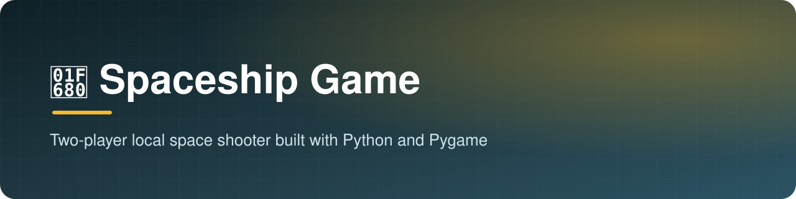
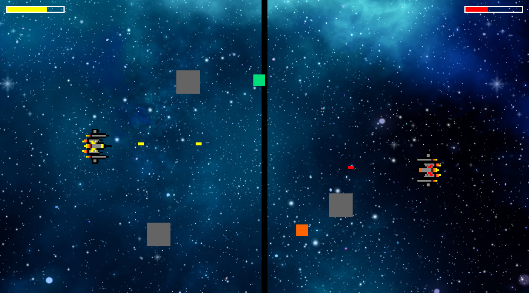

<p align="center">
  
</p>

<p align="center">
  
  
  
  
</p>

<p align="center">
  Two ships, one screen, one winner. Dodge obstacles, grab power-ups and shoot your friend out of the sky.
</p>

<p align="center">
  
</p>

## ✨ Features

- **Local 1v1 multiplayer** on a single keyboard, each player locked to their half of the arena
- **Random obstacles** that soak up bullets and change every round
- **Power-ups**
  - 🟩 **Health**: +1 HP, up to the maximum
  - 🟧 **Rapid fire**: automatic fire for 5 seconds
- **Health bars**, sound effects for shots, hits and pickups, and a winner screen
- Object-oriented design: `Spaceship`, `Bullet`, `Obstacle` and power-up classes

## 🎮 Controls

| | Move | Shoot |
|---|---|---|
| 🟡 **Player 1 (yellow)** | `W` `A` `S` `D` | `Left Ctrl` |
| 🔴 **Player 2 (red)** | Arrow keys | `Right Ctrl` |

Each ship starts with **10 HP**. The first to reach 0 loses.

## 🚀 Run it

```bash
git clone https://github.com/AbdulMuhaiminKhan/Spaceship-game.git
cd "Spaceship-game/Pygame Project Submission – Abdul Muhaimin khan"
pip install pygame
python game_abdulkhan.py
```

> Run the game from inside its folder so it can find the `Assets/` directory (sprites, background and sounds).

## 🧱 How it's built

| Component | Responsibility |
|---|---|
| `Spaceship` | Position, health, movement bounds, shooting and the rapid-fire timer |
| `Bullet` | Movement and collision with ships, obstacles and screen edges |
| `Obstacle` | Randomly placed blocks that stop bullets |
| `healthPowerUp` / `RapidFirePowerUp` | Spawn at random positions and apply their effect on contact |
| `draw_health_bar` / `draw_window` | Render the HUD and every object each frame at 60 FPS |

Hits are sent through custom Pygame events (`yellow_hit`, `red_hit`), which keeps collision detection separate from game-state updates.

## 📁 Project structure

```
Spaceship-game/
├── docs/                       # banner and gameplay screenshot
└── Pygame Project Submission – Abdul Muhaimin khan/
    ├── game_abdulkhan.py       # the whole game
    └── Assets/                 # sprites, background and sound effects
```

---

<p align="center">Made by <a href="https://github.com/AbdulMuhaiminKhan">Abdul Muhaimin Khan</a></p>
